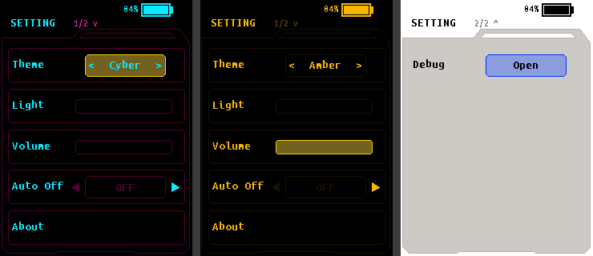
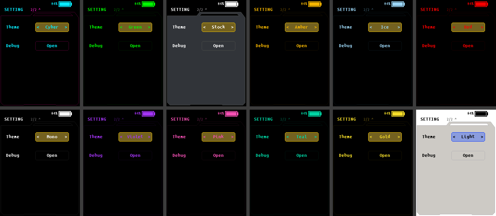
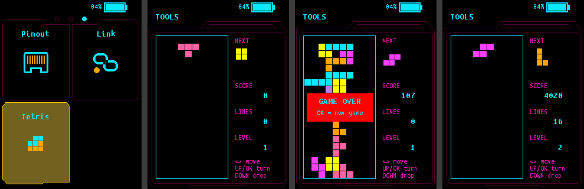

# LPM-10A custom firmware: Spentek edition

Unofficial firmware mods for the **FNIRSI LPM-10A** network cable tester (the "TX" unit) and its tone
probe (the "RX" unit, or wand), flashed and built entirely from Linux.

This is a fork of **[patnawa/LPM-10A_PN_Custom](https://github.com/patnawa/LPM-10A_PN_Custom)** by
**Pat Nawa**. All of the reverse engineering groundwork, the SDK, the emulator, the measurement fixes
and the base firmware builds this project patches are his work. Everything here sits on top of his
PN2.34 tester build and PN1.30 probe build. His original README is kept as
[README-UPSTREAM.md](README-UPSTREAM.md) and his `LPM-10A/` and `docs/` trees are unchanged.

---

## ⚠️ DISCLAIMER: READ THIS BEFORE YOU FLASH ANYTHING

**THIS FIRMWARE IS UNOFFICIAL, EXPERIMENTAL AND PROVIDED "AS IS", WITH NO WARRANTY OF ANY KIND.**

- **You flash it entirely at your own risk.** The authors and contributors of this repository and of
  the upstream project are **not liable** for anything that happens if you choose to use it. That
  includes, without limit: a bricked or unbootable device, lost calibration or settings, wrong or
  misleading test results, damaged cables or network equipment, battery problems, lost time and lost
  money.
- **It is not made, endorsed or supported by FNIRSI.** Flashing it will almost certainly void your
  warranty.
- **It is binary-patched closed firmware.** Nobody here has the manufacturer's source code. The
  patches were written against one firmware version and tested on **one tester and one probe**.
  Hardware revisions differ, and yours may not behave the same way.
- **Most testing was done in an emulator.** Each build below says whether it has actually run on
  hardware. "Works in the emulator" is not the same as "works on your bench".
- **Do not rely on it for safety or for paid certification work.** The tester's Cable Test verdict
  is a DC continuity check. It cannot detect split pairs and says nothing about whether a cable
  meets a category rating. The probe's mains mode is not a substitute for a real voltage tester.
- **Unexpected behaviour is possible**, including crashes and reboots. One crash bug in this very
  project was only found after it had been flashed (see [Lessons](#lessons-learned)).
- **Keep a known-good image to go back to,** and make sure you can enter recovery mode on both units
  *before* you flash a build from here.

If you are not comfortable recovering a device that will not boot, do not flash this.

---

## What is here

| Path | Contents |
|---|---|
| `spentek/firmware/tester/` | Tester update images |
| `spentek/firmware/probe/` | Probe update images |
| `spentek/firmware/SHA256SUMS` | Checksums for all of the above |
| `spentek/tools/lpmflash.py` | Guarded flasher for both units (Linux) |
| `spentek/tools/fatpush.py` | Raw FAT writer the probe's bootloader needs (Linux) |
| `spentek/src/` | Build scripts, C sources and emulator checks |
| `spentek/img/` | Emulator screenshots |
| `LPM-10A/`, `docs/`, `README-UPSTREAM.md` | Upstream project, unchanged |

### Builds

| Unit | File | Status |
|---|---|---|
| Tester | `LPM-10A-TX_PN2.35F-space.bin` | Latest. Emulator-tested; **not yet confirmed on hardware** |
| Tester | `LPM-10A-TX_PN2.35C-settings.bin` | **Confirmed on hardware.** Has Thai, 5 themes, no Tetris resume |
| Probe | `APP_LPM-10RX_PN1.30-spence6-update.bin` | Latest. Emulator-tested; **not yet confirmed on hardware** |
| Probe | `APP_LPM-10RX_PN1.30-spence4-update.bin` | **Confirmed on hardware.** No saved settings, no auto mode |

---

## Tester features



**Look**
- Twelve colour themes, switchable live from Settings: Cyber, Green, Stock, Amber, Ice, Red, Mono,
  Violet, Pink, Teal, Gold and Light. The choice is saved at power-off.
- Boot splash with a custom logo in place of the stock animated one.
- Battery level as a percentage next to the icon (`CHG` while charging).

**Settings**
- The Settings list scrolls to a second page. Theme takes the first row; Debug is on page two.
- English only: the second language and the first-boot language picker are removed, and the flash
  space its letter shapes used is reclaimed.

**Tools page** (a third Home page with its own icons)
- **Pinout**: T568A / T568B reference.
- **Link**: live link monitor with speed, duplex, partner abilities, uptime and a drop counter.
- **Tetris**: plays in the tool page; leaving it pauses the game and reopening resumes.

**Cable Test**
- A coloured verdict bar under the wire map: `PASS STRAIGHT`, `PASS CROSSOVER`, `PASS GIG XOVER`,
  `PASS ROLLOVER`, `PASS 4 PAIRS`, `PASS 2 PAIRS (10/100)`, or `FAIL OPEN / SHORT / MISWIRE` with the
  pin numbers. The measurement itself is upstream's and is unchanged.

**Debug page**
- Boot count and reset cause, the upstream crash record (PC / LR / CFSR), free heap, uptime, battery
  millivolts, and an event log that survives a warm reset.

**Fixes**
- A stock log routine read past an eight-entry name table for the added Home tiles and could crash
  the tester; the lookup is now bounded.




Screenshots are from the emulator with the theme colours applied.

### Tester limits worth knowing
- Wire colours are only true in the Stock theme. The others fold blues and greens into one hue.
- The verdict cannot tell T568A from T568B on a straight cable (they are electrically identical),
  and Switch mode cannot see crossover at all.
- The battery percentage uses a generic lithium curve, not one measured on this battery.
- Tetris has no soft drop: DOWN is a hard drop, because the firmware gives that key no repeat there.

---

## Probe features

Everything below is added on top of upstream's PN1.30 probe build, which already brings graded signal
strength and its own detection fixes (see [README-UPSTREAM.md](README-UPSTREAM.md)).

**Tracing sound**
- **"Waka" tracing pulses**: each pulse sweeps in pitch, and successive pulses alternate between
  rising and falling.
- **Pitch follows strength**: the stronger the signal, the higher the whole sweep, in eight steps.
  This is on top of upstream's faster-beeps-when-stronger behaviour.
- **Three sound themes** for the tracing pulses: Waka sweep (default), plain beeps, and a short
  Geiger-style click.
- **Three volume levels**: full, medium and low. They apply to every sound the probe makes,
  including key beeps and mains mode.

**Finding the right cable**
- **Signal-lost alarm**: four falling notes when a strong signal suddenly stops, so you know you
  slid off the cable. A signal that fades out gradually does not trigger it.
- **Peak hold**: remembers the strongest signal since it was switched on. A new best plays as a
  high-pitched pulse, signals within one step of the best sound normally, and anything weaker is
  muted. Switch it off and on again to start fresh.
- **Auto mode** (optional, off by default): when no tone has been heard for about a second, the
  probe switches between Digital and Analog by itself, silently, and locks onto whichever the
  tester is sending. It does nothing in Mains mode.
- **Mode announce**: 1 blip for Digital, 2 for Analog, 3 for Mains, so you know the mode without
  looking at the LEDs.

**Lamp**
- **Four lamp modes**: normal flashlight; lamp flashes with each tracing pulse, with sound; lamp
  only, with the tracing sound off (silent mode); and a 10 Hz strobe.
- In the two follow-the-signal modes and in strobe the lamp is automatic, so a short press of the
  lamp key does not toggle it.
- Each lamp mode is announced by 1 to 4 blips.

**Power and battery**
- **Power-on tune**: a short rising fanfare in place of the stock beep.
- **Battery level at power-on**: 1 to 4 blips after the tune (under 3.70 V, 3.70 V, 3.85 V, 4.00 V
  and up).
- **Low-battery warning in use**: a low double blip once a minute below 3.60 V.
- **Idle reminder**: one high chirp after 3 minutes with no signal and no key press, repeating
  every 3 minutes, so the probe does not get left switched on.
- **Auto power-off** extended from 5 to 15 minutes.

**Settings that survive power-off**
- Volume, sound theme, lamp mode and auto mode are written to the probe's flash 3 seconds after the
  last change. Peak hold always starts off, and strobe is stored as the normal lamp mode so the
  probe never powers on flashing.

**Keys**
- Every key now has long and extra-long holds, with a tick to tell you when each is reached (see
  the table below). Short presses do what they always did.
- Silent mode also silences the signal-lost alarm, the low-battery warning and the idle reminder.
  Key feedback and mode announcements still sound.

### Probe key gestures

A hold gives one tick at about 0.75 s (long) and a double tick at about 2.5 s (extra-long). The
action happens on release.

| Key | Short press | Long | Extra-long |
|---|---|---|---|
| Mode | Digital / Analog | Volume | Sound theme |
| Mains | Mains mode | Peak hold on / off | Auto mode on / off |
| Lamp | Flashlight | Lamp mode | (unused) |

---

## Flashing from Linux

Both units present a small USB drive in recovery mode, but neither works with a normal file copy
from Linux. `spentek/tools/lpmflash.py` wraps the method that does work and refuses to write to
anything that does not look like the right drive.

```
sudo ./lpmflash.py check FILE          # validate an image without touching a device
sudo ./lpmflash.py tx FILE [/dev/sdX]  # tester
sudo ./lpmflash.py rx FILE [/dev/sdX]  # probe (needs fatpush.py next to it)
```

**Tester**: power off, hold **M + Power**, plug in USB-C. A 448 KB drive appears. The kernel's FAT
driver either ignores writes or hangs the unit, so the flasher uses `mtools`
(`MTOOLS_SKIP_CHECK=1 mcopy -i /dev/sdX FILE ::`). If the tester hangs, press the reset button and
enter recovery again.

**Probe**: power off, hold **SCAN**, plug in USB. A 100 MB drive labelled `BOOTLOADER` appears. Its
bootloader only accepts a file whose data starts at cluster 4, which no ordinary copy produces;
`fatpush.py` writes the FAT structures directly to do that. The drive disappearing afterwards is
the success signal.

Requires Python 3 and `mtools`. Run `check` first, and compare the checksum with `SHA256SUMS`.

---

## Building

The sources in `spentek/src/` are the working scripts this was developed with, not a polished build
system. **They contain hard-coded paths and will need editing before they run on your machine.**

- **Tester**: a chain of binary patch stages on upstream's `PN2.34-cable-session` image:
  `build_tx.py` → `build_diag.py` → `build_theme.py` → `build_cyber.py` → `build_x.py`
  (which runs `build_apps6.py` and `build_v.py` and compiles `tetris.c`).
- **Probe**: `build_rx6.py` appends the compiled `probe.c` to upstream's `PN1.30` raw image and
  redirects three call sites.
- Tools needed: Python 3 with `keystone-engine`, `capstone`, `unicorn` and `Pillow`; `clang` with ARM
  targets, `ld.lld` and `llvm-objcopy`.
- The `check_*.py` and `emu*.py` scripts run the patched code in upstream's emulator or a small one
  of their own.

---

## Lessons learned

- **The emulator skips some firmware functions.** Upstream's emulator stubs out the firmware's log
  formatting, so a crash inside it (the name-table bug above) never showed up in testing. It took a
  crash record read from the device to find it.
- **On battery, any reset looks like a power loss.** The tester holds its own power on through a
  pin that a reset releases, so RAM, the crash record and any log are wiped. Reproduce crashes with
  USB power connected if you want the evidence to survive.

---

## Credits and licence

- **Pat Nawa** ([patnawa/LPM-10A_PN_Custom](https://github.com/patnawa/LPM-10A_PN_Custom)): the
  upstream project, SDK, emulator and base firmware builds. MIT licensed.
- **Spence** ([spen1995](https://github.com/spen1995)): the mods in `spentek/`.
- The underlying firmware is **FNIRSI's**. This project distributes patched images of it, as
  upstream does, and claims no rights over the manufacturer's code.

The code in this repository is under the MIT licence; see [LICENSE](LICENSE). The licence's
no-warranty and no-liability terms apply in full, in addition to the disclaimer above.

---

## Current release

| Unit | Version | File | SHA-256 |
|---|---|---|---|
| Tester | PN2.35F | [`LPM-10A-TX_PN2.35F-space.bin`](spentek/firmware/tester/LPM-10A-TX_PN2.35F-space.bin) | `383ea45f380110b32629411cb7727a82e875e7a6735e3888c844cbfb4587c843` |
| Probe | PN1.30 build 6 | [`APP_LPM-10RX_PN1.30-spence6-update.bin`](spentek/firmware/probe/APP_LPM-10RX_PN1.30-spence6-update.bin) | `002667afeed9c76d76ecd079a494d4bc57fe56d31d5118149e2aab729c48b962` |

Both are emulator-tested and **not yet confirmed on hardware**. The last hardware-confirmed builds are
`LPM-10A-TX_PN2.35C-settings.bin` and `APP_LPM-10RX_PN1.30-spence4-update.bin`, in the same folders.
Read the disclaimer at the top of this page before going further.

### How to apply it (Linux)

**1. Get the files and tools**

```
git clone https://github.com/spen1995/LPM-10A_PN_Custom_Firmware
cd LPM-10A_PN_Custom_Firmware/spentek
sudo pacman -S mtools python        # Arch; on Debian/Ubuntu: sudo apt install mtools python3
chmod +x tools/lpmflash.py tools/fatpush.py
```

**2. Check the images before touching a device**

```
(cd firmware && sha256sum -c SHA256SUMS)
tools/lpmflash.py check firmware/tester/LPM-10A-TX_PN2.35F-space.bin
tools/lpmflash.py check firmware/probe/APP_LPM-10RX_PN1.30-spence6-update.bin
```

Every line must say `OK` or `a valid ... update image`. Stop if one does not.

**3. Flash the tester**

1. Power the tester off.
2. Hold **M**, then press **Power**, and keep holding while you plug in the USB-C cable.
3. A 448 KB drive appears. Do **not** mount it or open it in a file manager.
4. Run:

```
sudo tools/lpmflash.py tx firmware/tester/LPM-10A-TX_PN2.35F-space.bin
```

5. Type `yes` when asked. When it finishes, unplug and power on. **Settings → About** should show
   `PN2.35F`.

If the tester hangs or shows nothing, press its reset button and repeat from step 1.

**4. Flash the probe**

1. Power the probe off.
2. Hold **SCAN** and plug in the USB cable.
3. A 100 MB drive labelled `BOOTLOADER` appears. Do **not** mount it.
4. Run:

```
sudo tools/lpmflash.py rx firmware/probe/APP_LPM-10RX_PN1.30-spence6-update.bin
```

5. Type `yes` when asked. The drive disappearing is the success signal. Unplug and power on: you
   should hear the power-on tune, then 1 to 4 blips for the battery level.

If the drive is still there afterwards and holds a file called `UNKOWN.TXT`, the bootloader rejected
the image. Unplug, start again from step 1, and run the command once more.

**5. Going back**

Flash an older image the same way. The hardware-confirmed builds above are in this repository, and
upstream's original builds are under `LPM-10A/Firmware File/`.

The flasher refuses to write unless the drive matches what it expects (size, label, not mounted), and
it picks the drive itself; pass the device as a last argument, for example `/dev/sdb`, only if it
tells you to.

Windows and macOS are not covered here. Upstream's README describes its own update procedure.
